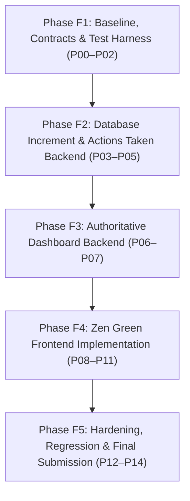

# TokTickIT Lab 4 — Master Plan & Execution Roadmap (Plan_lab4)

> ⚠️ **CRITICAL INSTRUCTION FOR ALL AGENTS / SESSIONS:**  
> **ก่อนเริ่มลงมือทำงานใน Lab 4 ทุกครั้ง ต้องอ่านไฟล์นี้ (`Plan_lab4.md`) ให้ครบถ้วนก่อนเสมอ** เพื่อทำความเข้าใจสถานะปัจจุบัน, รายละเอียดงานในแต่ละเฟส, กฎเกณฑ์ทางวิศวกรรมซอฟต์แวร์ และลำดับการส่งมอบงาน

---

## 1. ข้อมูลสังเขปของ Lab 4 (Sprint 4 Overview)

- **วิชา:** CPE 334 Introduction to Software Engineering in the Age of AI Agents (1/2026)
- **คะแนนเต็ม:** 60 คะแนน
- **เป้าหมายหลัก:** เพิ่มระบบ **Actions Taken** (Parent-Child สำหรับ IT Staff บันทึกการปฏิบัติงาน), บังคับใช้ **Ticket Workflow & Resolution Rules** ขั้นสุดท้าย, สร้าง **Role-Appropriate Dashboards** (Requester, IT Staff, Admin) และทำ **Final Hardening & Full Regression**
- **สถาปัตยกรรม & เทคโนโลยี:**
  - Frontend: React / TypeScript / Vite / Bootstrap (Zen Green Design Language)
  - Backend: Express / TypeScript / Prisma ORM / PostgreSQL
  - Testing: Vitest / Supertest / Playwright (E2E)
- **หลักการดำเนินงาน:** Spec DD → Test DD → TDD → Full Verification & Peer Review

---

## 2. ขอบเขตงาน (In-Scope) และสิ่งที่ไม่รวม (Explicitly Excluded)

### In-Scope (สิ่งที่ต้องทำ)
1. **Actions Taken:** 
   - 1 Ticket มีได้หลาย Actions Taken (One-to-Many)
   - ฟิลด์: Action Date/Time, Action Description, Result, Performed by (auto จาก session ของ IT Staff), Follow-Up Required? (boolean), Follow-up Note (บังคับเมื่อ follow-up=true), Attachment Notes
   - สิทธิ์: IT Staff และ Admin สร้าง/แก้ไขได้; Requester ดูได้เฉพาะ ticket ของตน (Read-only); ปฏิเสธ inactive staff
2. **Ticket Workflow & Resolution Gate:**
   - สถานะทั้ง 8: `New`, `Open`, `In Progress`, `Waiting for Requester`, `Resolved`, `Closed`, `Reopened`, `Cancelled`
   - Requester แจ้งว่าปัญหาดูเหมือนแก้แล้วได้เฉพาะแบบ Advisory (ไม่เปลี่ยนสถานะตั๋ว); IT Staff เท่านั้นที่เปลี่ยนเป็น `Resolved` ได้
   - มี Optimistic Concurrency Control / Stale-update handling (HTTP 409 Conflict) ป้องกันการบันทึกทับกัน
3. **Role-Appropriate Dashboards:**
   - **Requester Dashboard:** แสดงเฉพาะตั๋วของตนเอง (Total Open, Waiting for Requester, Recently Updated, Recently Resolved, Quick Actions, Drill-down)
   - **IT Staff Dashboard:** แสดงภาพรวมทีมและงานส่วนตัว (Unassigned, My Assigned, แยกตาม status/priority, Recently Updated, Quick Actions, Drill-down)
   - **Administrator Dashboard:** แสดง Dashboard ของ IT Staff + Concise User-Account Stats
   - ทุกค่าตัวเลขคำนวณจาก Backend โดยตรง (Authoritative Data)
4. **Zen Green UI & Accessibility:**
   - รองรับ Responsive 3 ขนาด: Mobile (375px), Tablet (768px), Desktop (1280px+)
   - Accessibility: Keyboard navigation, Focus ring, ARIA labels, Non-color cues, ไม่มี Text clipping หรือ Horizontal scroll
5. **Regression & Hardening:**
   - ฟังก์ชันเดิมของ Lab 1–3 (Auth, Attachments, Comments, Internal Notes, Admin User Management) ต้องทำงานได้ 100% ไม่พัง

### Excluded (สิ่งที่ห้ามทำเด็ดขาดตามข้อกำหนด Lab 4.2)
- ❌ Automatic SLA clocks, escalation engines, on-call scheduling, breach notifications
- ❌ Email, SMS, LINE, Push notifications
- ❌ Inventory consumption, spare-parts, purchasing, cost accounting
- ❌ Time-sheet billing, payroll, labor-cost calculation
- ❌ Multi-level approval workflows, electronic signatures
- ❌ Advanced BI tools, custom report builders, export warehouses
- ❌ Multi-tenant organizations, cloud operations

---

## 3. แผนการดำเนินงาน 5 เฟส (F1 – F5) และ 15 แพ็กเกจงาน (P00 – P14)

---

### 🟢 Phase F1: Baseline, Engineering Contracts & Test Harness (P00 – P02)
*วัตถุประสงค์: ตรวจสอบความพร้อมของฐานระบบ และจัดทำ Engineering Contracts 4 ฉบับตามแนวทาง Spec DD ก่อนเริ่มโค้ด*

- [x] **P00: Baseline Verification & Environment Audit** (Completed - see `docs/lab-04/baseline.md`)
  - ตรวจสอบ commit ล่าสุดบน `main` (`1f2e3abe7b3ac0f6784f281c9fb7e808def488ce`), ความสมบูรณ์ของ source code จาก Lab 3
  - ตรวจสอบ dependencies, scripts, และ test runner
  - บันทึกสถานะ baseline ลงในเอกสาร `docs/lab-04/baseline.md`
- [x] **P01: Sprint 4 Engineering Contracts (Spec DD Deliverable)** (Completed)
  - จัดทำ `docs/lab-04/specification.md` (Sprint Goal, FR-01 ถึง FR-11, BR-01 ถึง BR-14, AC-01 ถึง AC-28, DoD, Database Design Justifications)
  - จัดทำ `docs/lab-04/api-spec.md` (Actions Taken endpoints, Dashboard endpoints, Workflow & OCC, Error codes)
  - จัดทำ `docs/lab-04/ui-spec.md` (Zen Green tokens, Staff & Requester Dashboards, Actions Taken forms, Responsive breakpoints 375/768/1280px, Accessibility checklist)
  - จัดทำ `docs/lab-04/tests.md` (Test matrix ผูก AC-01 ถึง AC-28 เข้ากับ Test files ทุกประเภท)
  - ร่าง `docs/lab-04/reviewer.md` และ `docs/lab-04/ai-use.md`
- [x] **P02: Test Harness & Workspace Structure** (Completed)
  - เตรียมไดเรกทอรีทดสอบตามข้อกำหนด:
    - `server/tests/lab-04/`
    - `client/tests/lab-04/`
    - `e2e/lab-04/`
    - `artifacts/lab-04/screenshots/` (`staff-dashboard/`, `requester-dashboard/`, `actions-taken/`)
  - ตรวจสอบความปลอดภัยของ Test Isolation (HARNESS-01 isolation & pre-flight hooks)

---

### 🟢 Phase F2: Database Increment & Actions Taken Backend (P03 – P05)
*วัตถุประสงค์: ขยายสกีมาฐานข้อมูล, ระบบ Seed และพัฒนา API จัดการ Actions Taken และ Workflow*

- [x] **P03: Prisma Migration & Idempotent Seed Data** (Completed)
  - เพิ่ม Model `ActionTaken` ใน `server/prisma/schema.prisma`:
    - ฟิลด์: `id`, `ticketId`, `actionDateTime`, `description`, `result`, `performedById`, `followUpRequired`, `followUpNote`, `attachmentNotes`, `version`, `createdAt`, `updatedAt`
    - ความสัมพันธ์: `Ticket` (1:N), `User` (N:1 สำหรับ performedBy)
    - Indexes สำหรับ Query และ Performance (`[ticketId, actionDateTime]`, `performedById`)
  - สร้าง Prisma migration `20261018000000_lab4_actions_taken` ที่รักษาข้อมูลเก่า (Non-destructive)
  - ปรับปรุง `seed.ts` ให้เป็น Idempotent: สร้างข้อมูลทดสอบ Actions Taken (Tickets ที่มี 0, 1 และหลาย actions; ค่า follow-up หลากหลาย)
- [x] **P04: Actions Taken REST API & Authorization** (Completed)
  - Implement endpoints:
    - `POST /api/tickets/:id/actions` (สร้าง Actions Taken)
    - `GET /api/tickets/:id/actions` (ดึงรายการ Actions Taken เรียงตามเวลา)
    - `PATCH /api/actions/:id` (แก้ไข Actions Taken พร้อม OCC)
  - Authorization & Validation:
    - Performed by ผูกกับ session user อัตโนมัติ (`req.user.id`)
    - ตรวจสอบสถานะ User active (ปฏิเสธ inactive user ด้วย 403)
    - Validation: ถ้า `followUpRequired = true` ต้องระบุ `followUpNote`
    - Requester อ่านได้อย่างเดียวสำหรับ ticket ของตน (ห้ามสร้าง/แก้ไข ได้ 403; ticket คนอื่นได้ 404)
    - Decision D4: แก้ไขได้เฉพาะ Author หรือ Administrator (staff อื่นได้ 403 ACTION_EDIT_FORBIDDEN)
    - Decision D5: ปฏิเสธการเพิ่ม/แก้ไขบน locked tickets (RESOLVED/CLOSED/CANCELLED) ด้วย 400 TICKET_LOCKED
- [x] **P05: Ticket Workflow, Resolution Gate & Concurrency Control** (Completed)
  - Implement Status Transition Matrix ที่ Backend:
    - สถานะ 8 สถานะตาม Baseline เดิม
    - Resolution Gate (Decision D2): Transition สู่ `RESOLVED` ต้องมีเจ้าหน้าที่ active owner และมี Actions Taken อย่างน้อย 1 รายการ (หากไม่มี คืน 400 ACTION_REQUIRED)
    - Decision D6: สิทธิ์การเปลี่ยนสถานะครอบคลุมทั้ง `IT_STAFF` และ `ADMINISTRATOR`
    - Requester ส่งคำขอ advisory แจ้งปัญหาดูเหมือนคลี่คลาย (`POST /api/tickets/:id/appears-resolved`) โดยไม่เปลี่ยนสถานะตั๋ว
  - Optimistic Concurrency Control: ตรวจสอบ `expectedVersion` คืน 409 VERSION_CONFLICT เมื่อชนกัน

---

### 🟢 Phase F3: Authoritative Dashboard Backend (P06 – P07)
*วัตถุประสงค์: สร้าง API สำหรับ Dashboard ที่คำนวณจากฐานข้อมูลอย่างถูกต้อง รวดเร็ว และปลอดภัย*

- [ ] **P06: Requester Dashboard API**
  - Endpoint `GET /api/dashboard/requester`
  - คำนวณ Metrics เฉพาะของ Requester ปัจจุบัน:
    1. Total Open Tickets
    2. Tickets Waiting for Requester
    3. Recently Updated Tickets
    4. Recently Resolved Tickets
  - ส่ง Recent Tickets (สูงสุด 5 รายการ) พร้อม status, updated time และ drill-down params
  - Data isolation: ห้ามมีข้อมูลตั๋วของผู้อื่นปนเปื้อนเด็ดขาด
- [ ] **P07: IT Staff & Admin Dashboard API**
  - Endpoint `GET /api/dashboard/staff`
  - คำนวณ Metrics:
    1. New / Unassigned Tickets
    2. Open / In Progress Tickets
    3. My Assigned Tickets (ของ staff ที่ล็อกอิน)
    4. Tickets Waiting for Requester
    5. สรุปตาม Status & IT Priority
  - ส่ง Recent Tickets ในคิวที่ต้องให้ความสนใจเร่งด่วน
  - รองรับ Admin: สรุป User Accounts (Total Users, Active Staff, Inactive)
  - กำหนด Empty behavior และ Drill-down query paths ชัดเจน

---

### 🟢 Phase F4: Zen Green Frontend Implementation (P08 – P11)
*วัตถุประสงค์: พัฒนา UI ให้สวยงามตาม Zen Green Design, Responsive, Accessible และเชื่อมต่อ API สมบูรณ์*

- [ ] **P08: Actions Taken UI on Ticket Detail**
  - แสดงรายการ Actions Taken ในหน้า Ticket Detail (ตารางหรือการ์ดที่เรียงตามเวลาอย่างเสถียร)
  - ฟอร์มสร้าง/แก้ไข Action Taken สำหรับ IT Staff:
    - Auto-display ผู้ดำเนินการจาก User Profile ปัจจุบัน
    - Date/Time picker หรือค่าเริ่มต้นเวลาปัจจุบัน
    - Input Description & Result
    - Toggle `Follow-up Required?` (เมื่อเปิดจะบังคับให้กรอก Follow-up Note พร้อม validation message)
    - Attachment Notes input
  - มุมมองสำหรับ Requester: แสดงรายการ Actions Taken แบบ Read-only ชัดเจน
- [ ] **P09: Ticket Workflow & Status Transition UI**
  - ปรับ UI ใน Ticket Detail ให้แสดงปุ่ม/ตัวเลือกเปลี่ยนสถานะเฉพาะที่ผู้ใช้นั้นมีสิทธิ์ทำได้
  - ป้ายสถานะ (Badges) และสีตาม Zen Green ให้ความแตกต่างที่มองเห็นชัดเจนโดยไม่พึ่งพาสีเพียงอย่างเดียว
  - จัดการ Error 409 Concurrency Conflict: แสดงแจ้งเตือนและมีปุ่ม Reload ข้อมูลล่าสุดโดยไม่ทำให้ข้อมูลที่กรอกค้างไว้สูญหาย
- [ ] **P10: IT Staff & Admin Dashboard Screen**
  - หน้า Dashboard สำหรับ IT Staff (`/dashboard`):
    - Welcome Banner & Header
    - Metric Cards: New, Open, In Progress, Waiting for Requester, My Assigned
    - แต่ละการ์ดคลิกแล้ว Drill-down ไปที่ Ticket Queue (`/staff/tickets?status=...` หรือ `owner=mine`)
    - อัปเดต `StaffQueuePage.tsx` ให้อ่าน filter จาก URL search params สำหรับ drill-down
    - Section "My Recent Tickets" พร้อมปุ่ม View all
    - Quick Actions panel (Create Ticket, Search Tickets, My Queue -> `/staff/tickets?owner=mine`)
    - Responsive layout (Grid/Flexbox สลับแสดงผลตามขนาดหน้าจอ)
- [ ] **P11: Requester Dashboard Screen**
  - หน้า Dashboard สำหรับ Requester (`/dashboard`):
    - Welcome Banner
    - Metric Cards: My Open Tickets, In Progress, Resolved, Closed (คลิก Drill-down ไปหน้า My Tickets พร้อม filter status)
    - อัปเดต `MyTickets.tsx` ให้อ่าน filter จาก URL search params สำหรับ drill-down
    - Section "My Recent Tickets"
    - Quick Actions panel (Create Ticket, View My Tickets)
    - Responsive layout และ Loading skeletons

---

### 🟢 Phase F5: Hardening, Full Regression, Verification & Submission (P12 – P14)
*วัตถุประสงค์: ตรวจสอบคุณภาพขั้นสูงสุด รวบรวมหลักฐาน และจัดทำรายงานส่ง 60 คะแนน*

- [ ] **P12: Comprehensive Automated Testing & Traceability**
  - **Server API Tests (`server/tests/lab-04/`):**
    - `actions-taken.api.test.ts`
    - `ticket-workflow.api.test.ts`
    - `requester-dashboard.api.test.ts`
    - `staff-dashboard.api.test.ts`
  - **Client Component Tests (`client/.../lab-04 tests/`):**
    - `StaffDashboard.test.tsx`
    - `RequesterDashboard.test.tsx`
    - `ActionsTaken.test.tsx`
    - `TicketWorkflow.test.tsx`
  - **E2E Tests (`e2e/lab-04/`):**
    - `actions-taken-flow.spec.ts`
    - `ticket-resolution.spec.ts`
    - `dashboards.spec.ts`
  - **Regression Testing:** รัน Test Suites ทั้งหมดของ Lab 1, Lab 2, Lab 3 เพื่อยืนยันว่าไม่มีจุดใดพัง
- [ ] **P13: Accessibility, Responsive Verification & Screenshots Capture**
  - ทดสอบและแคปภาพหน้าจอที่ความกว้าง 375px (Mobile), 768px (Tablet), 1280px (Desktop)
  - เก็บ Screenshots ลงใน `artifacts/lab-04/screenshots/`:
    - `staff-dashboard/`
    - `requester-dashboard/`
    - `actions-taken/`
  - ตรวจสอบ Keyboard focus, Tab order, Screen reader attributes (ARIA), ไม่มี Text overlapping หรือ Overflow
- [ ] **P14: Git Workflow, Review & Final PDF Submission**
  - จัดทำ `docs/lab-04/reviewer.md` บันทึก PR links, Peer Reviewer Identity, Feedback และ Approval
  - จัดทำ `docs/lab-04/ai-use.md` บันทึก LLM Prompt 6-10 ตัวอย่าง และข้อคิดเห็น Reflection
  - Merge feature branches สู่ `lab4-staging` แล้ว merge สู่ `main`
  - ตรวจสอบ Commit history และ SHA จริงบน `main`
  - ประกอบรายงาน PDF ฉบับสมบูรณ์แบ่งหัวข้อ **Answer Part 1 ถึง Answer Part 9** ตามโจทย์กำหนด 60 คะแนน

---

## 4. โครงสร้างรายงานส่งตรวจ (Answer Part 1 – 9 Mapping)

| ส่วนของรายงาน | คะแนน | สิ่งที่ต้องแสดงและเชื่อมโยง |
|---|---|---|
| **Answer Part 1: Git Use with Engineering Workflow** | 10 | หลักฐาน Commit history จาก feature branch → `lab4-staging` → `main`; GitHub Project/Kanban ที่ทุก Issue ย้ายไป Done; เอกสาร `reviewer.md` ที่มีลิงก์ PR, comments, approval จริง; โครงสร้าง repository |
| **Answer Part 2: Spec DD** | 5 | ลิงก์และเนื้อหา `docs/lab-04/specification.md` ครบถ้วน (FR, BR, Status transitions, Dashboard calculations, AC-xx, DoD); หลักฐานว่า Spec ถูกสร้างก่อนเริ่มโค้ด |
| **Answer Part 3: Test DD and Traceability** | 10 | ลิงก์และเนื้อหา `docs/lab-04/tests.md` พร้อมตาราง Traceability เชื่อมโยง AC สู่ Test files; ผลการรัน Automated Test ผ่านหมด 100% (Unit, API, UI, E2E, Regression) บน SHA ล่าสุดของ `main` |
| **Answer Part 4: AI Use with Reflection** | 5 | เนื้อหา `docs/lab-04/ai-use.md` ระบุ LLM ที่ใช้, Key Prompts 6–10 ข้อ, และข้อคิดเห็นสะท้อนการทำงานร่วมกับ AI |
| **Answer Part 5: Working IT Staff Dashboard UI** | 5 | ภาพและคำอธิบาย IT Staff Dashboard แสดงตัวเลขชี้วัดถูกต้อง, การเชื่อมโยงไปยัง Queue (Drill-down), Loading/Empty states, และหลักฐานว่าตัวเลขตรงกับ Query ฐานข้อมูล |
| **Answer Part 6: Working Actions Taken UI** | 10 | ภาพและหลักฐานการทำงานของ Actions Taken: สร้าง, แก้ไข, ป้องกัน Inactive assignee, Auto-actor, Follow-up validation, และการแสดงผลหลาย Action ใน 1 Ticket |
| **Answer Part 7: Working Ticket Workflow** | 5 | ภาพและหลักฐานการเปลี่ยนสถานะตาม Transition Matrix ที่ถูกต้อง, Resolution gate ที่ Requester ทำได้แค่ advisory และ IT Staff เป็นผู้สรุปปิดงาน |
| **Answer Part 8: Working Requester Dashboard & Regression UI** | 5 | ภาพ Requester Dashboard เฉพาะตั๋วตนเอง และหลักฐาน Full Regression ของฟีเจอร์เดิม (Auth, My Tickets, Attachments, Comments, Notes, Admin) |
| **Answer Part 9: Zen Green UI, Responsive, Accessibility & Polish** | 5 | เนื้อหา `ui-spec.md` พร้อมภาพหน้าจอครบ 3 ขนาด (Desktop, Tablet, Mobile) และ Accessibility Checklist (Keyboard focus, Labels, Contrast, No overflow) |
| **รวมคะแนนเต็ม** | **60** | |

---

## 5. กฎเหล็กประจำการพัฒนา (Operational Constraints)
1. **ห้ามแต่งตัวเลขหรือผลการทดสอบเด็ดขาด:** ผล Test Pass count, Commit SHA, ลิงก์ PR ต้องมาจากเครื่องและ GitHub จริงเท่านั้น
2. **ไม่ใช้ Database ซ้ำ:** การรัน Automated Test ที่มีการเปลี่ยนแปลงข้อมูล (Mutation) ต้องใช้ Test DB และ Uploads โฟลเดอร์แยกต่างหากเสมอ
3. **การแตก Branch:** Feature branch ให้ใช้รูปแบบ `codex/lab4-pNN-description` โดยแตกจากและเปิด PR เข้า `lab4-staging` แล้วจึง merge สู่ `main`
4. **ความเข้ากันได้ย้อนหลัง (Zero Regression):** โค้ดที่เพิ่มเข้ามาต้องไม่ทำลายการทำงานเดิมของ Lab 1–3
