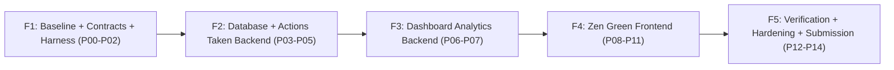

# TokTickIT Lab 4 — PHASES & Work Packages (F1–F5 / P00–P14)

เอกสารนี้อ้างอิงและเชื่อมโยงกับ master plan หลักที่ [Plan_lab4.md](file:///c:/Users/uesr/OneDrive/Desktop/HW/cpe334_SE/toktickit/Plan_lab4.md)

## สรุปเฟสและเกณฑ์จบ (Exit Gates)

| เฟส | งานย่อย | ชื่องาน | Exit Gate |
|---|---|---|---|
| **F1** | P00–P02 | Baseline, Contracts & Test Harness | สัญญา 4 ฉบับ (`specification.md`, `ui-spec.md`, `api-spec.md`, `tests.md`) ครบถ้วน, Traceability ครบทุก AC, สภาพแวดล้อม Test Harness ปลอดภัย |
| **F2** | P03–P05 | Data Increment & Actions Taken Backend | Migration ทั้ง fresh & populated ปลอดภัย; API Actions Taken & Status Transitions ผ่าน Unit/API Tests; Concurrency lock ทำงานถูกต้อง |
| **F3** | P06–P07 | Authoritative Dashboard Backend | Metric API ถูกต้องตาม business logic; Data isolation ของ Requester รัดกุม; Query มีประสิทธิภาพและรองรับ drill-down parameters |
| **F4** | P08–P11 | Zen Green Frontend Implementation | UI ตรงตาม Zen Green design system; รองรับ Desktop, Tablet, Mobile (375/768/1280px); Accessible (keyboard, focus, non-color cues); Component tests ผ่าน |
| **F5** | P12–P14 | Hardening, Full Regression & Submission | Automated test suite ทุกตัว (API, Unit, E2E) ผ่าน 100%; Screenshots ครบถ้วน; เอกสารและ PDF Answer Part 1–9 ครบถ้วนตรงความเป็นจริง |

รายละเอียดแต่ละแพ็กเกจงาน ดูได้ที่ [Plan_lab4.md](file:///c:/Users/uesr/OneDrive/Desktop/HW/cpe334_SE/toktickit/Plan_lab4.md)
